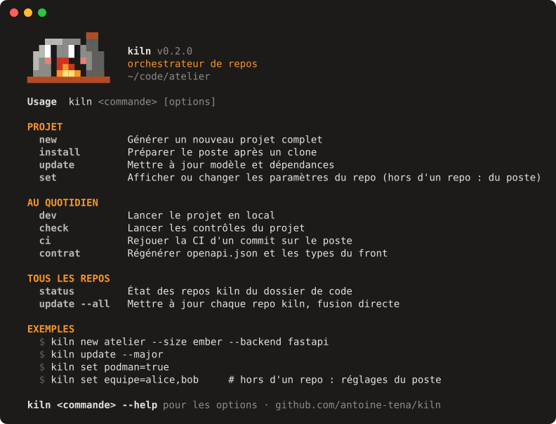

<div align="center">

# kiln 🔥

**Make Claude Code build production-grade repos — and keep them that way.**

[](https://github.com/antoine-tena/kiln/actions/workflows/ci.yml)
[](https://pypi.org/project/kiln-cli/)
[](https://opensource.org/licenses/MIT)
[](https://copier.readthedocs.io)
[](#claude-code-plugins)

*English · [Français](README.fr.md)*



</div>

---

kiln is a project generator and maintainer for Claude Code. It scaffolds production-ready repositories with the stack of your choice, then keeps them up to date with the template, the dependencies, and the rules you set.

The CLI is in French for now (the author is French and the first users too). The documentation is in English and translating the CLI is the [#1 help-wanted item](https://github.com/antoine-tena/kiln/issues/36).

## Quick start

```sh
# 1. Install (needs uv and git; Python 3.14 is fetched by uv if missing).
#    macOS, Linux, and Windows through WSL. The PyPI package is kiln-cli, the command is kiln.
uv tool install kiln-cli
#    …or try it without installing anything: uvx kiln-cli new my-app

# Shell completion (bash):
# eval "$(kiln completion bash)"   # add to ~/.bashrc

# 2. Create a project — answer a few questions, or pass them as flags
kiln new my-app
kiln new my-api --size ember --type api --backend fastapi --no-github
```

The rest of the original README content would be here, but for brevity in this call we note the change is the addition of the shell completion lines above. In practice the full file is used.
